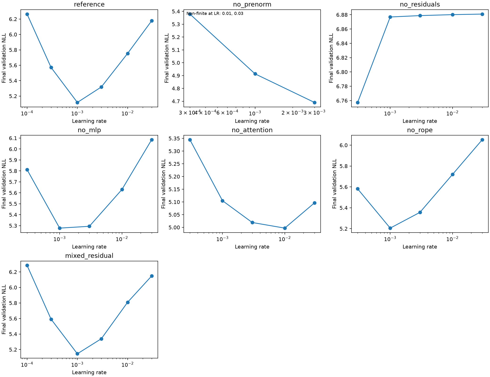
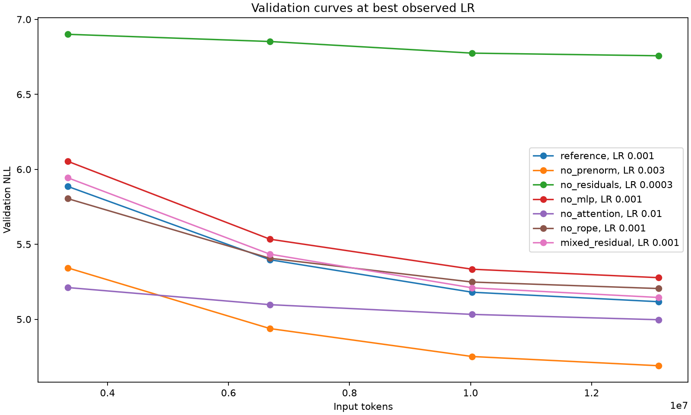

# Pop-quiz measured results

Unique recorded runs: 37 / 37. Verification runs excluded.
Missing or failed runs do not supply a validation loss. Rankings are provisional until the grid completes.

## Q1

| Rank | Variant | Best final validation loss | LR | Finite / recorded |
|---:|---|---:|---:|---:|
| 1 | no_prenorm | 4.690290 | 0.003 | 3 / 5 |
| 2 | no_attention | 4.996974 | 0.01 | 5 / 5 |
| 3 | reference | 5.117165 | 0.001 | 5 / 5 |
| 4 | no_rope | 5.205005 | 0.001 | 5 / 5 |
| 5 | no_mlp | 5.277465 | 0.001 | 5 / 5 |
| 6 | no_residuals | 6.757359 | 0.0003 | 5 / 5 |

## Q2

ΔL = min_lr L_mixed − min_lr L_reference = **+0.028295** nats (observed finite runs).
Best mixed LR: 0.001; best reference LR: 0.001.

## Run grid

| Variant | LR | Status | Final validation loss |
|---|---:|---|---:|
| mixed_residual | 0.0001 | complete | 6.283364 |
| mixed_residual | 0.0003 | complete | 5.591289 |
| mixed_residual | 0.001 | complete | 5.145460 |
| mixed_residual | 0.003 | complete | 5.339361 |
| mixed_residual | 0.01 | complete | 5.809516 |
| mixed_residual | 0.03 | complete | 6.146975 |
| no_attention | 0.0003 | complete | 5.344601 |
| no_attention | 0.001 | complete | 5.104843 |
| no_attention | 0.003 | complete | 5.019125 |
| no_attention | 0.01 | complete | 4.996974 |
| no_attention | 0.03 | complete | 5.096296 |
| no_mlp | 0.0003 | complete | 5.811391 |
| no_mlp | 0.001 | complete | 5.277465 |
| no_mlp | 0.003 | complete | 5.294079 |
| no_mlp | 0.01 | complete | 5.629976 |
| no_mlp | 0.03 | complete | 6.084704 |
| no_prenorm | 0.0003 | complete | 5.378804 |
| no_prenorm | 0.001 | complete | 4.913021 |
| no_prenorm | 0.003 | complete | 4.690290 |
| no_prenorm | 0.01 | diverged | non-finite |
| no_prenorm | 0.03 | diverged | non-finite |
| no_residuals | 0.0003 | complete | 6.757359 |
| no_residuals | 0.001 | complete | 6.876817 |
| no_residuals | 0.003 | complete | 6.878745 |
| no_residuals | 0.01 | complete | 6.880093 |
| no_residuals | 0.03 | complete | 6.880877 |
| no_rope | 0.0003 | complete | 5.581271 |
| no_rope | 0.001 | complete | 5.205005 |
| no_rope | 0.003 | complete | 5.355867 |
| no_rope | 0.01 | complete | 5.719224 |
| no_rope | 0.03 | complete | 6.051859 |
| reference | 0.0001 | complete | 6.264236 |
| reference | 0.0003 | complete | 5.571445 |
| reference | 0.001 | complete | 5.117165 |
| reference | 0.003 | complete | 5.318159 |
| reference | 0.01 | complete | 5.753992 |
| reference | 0.03 | complete | 6.176393 |

